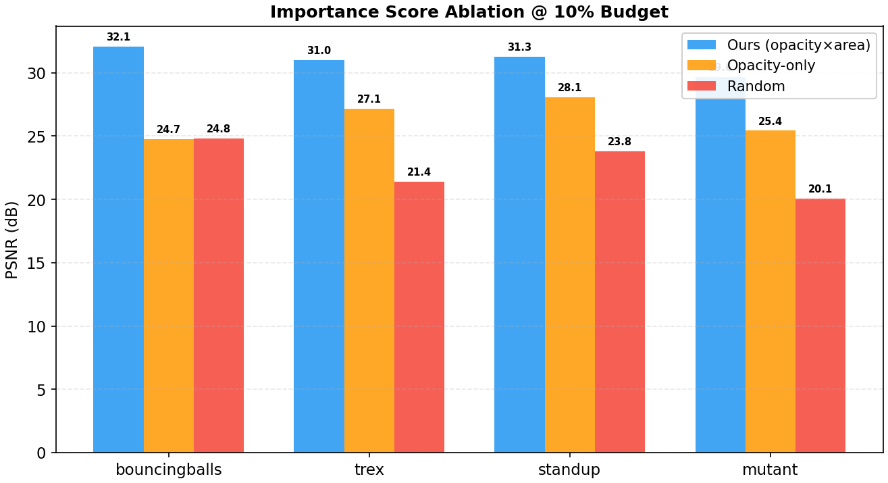

# Random Budget Training for Variable-Budget Rendering in 4D Gaussian Splatting

> Target journal: *The Visual Computer* (Springer)  
> English manuscript draft translated and polished from the Chinese version.  
> Figures are referenced using the local `figures/` directory.

---

## Abstract

4D Gaussian Splatting (4DGS) has recently become an effective representation for dynamic scene reconstruction and real-time novel view synthesis. However, after training, existing 4DGS models usually have a fixed number of Gaussian primitives, making it difficult to adapt the same model to deployment platforms with different computational budgets. A straightforward solution is to prune a trained model after optimization, but this can disrupt the implicit cooperation among primitives learned during full-capacity training and often leads to significant quality degradation under low-budget rendering. Training a separate model for each target budget, on the other hand, increases training, storage, and maintenance costs.

This paper studies a practical question: can a single 4DGS model be trained once and then directly truncated according to a target primitive budget while maintaining usable rendering quality across different budget levels? Inspired by Matryoshka representation learning and its recent use in static 3D Gaussian Splatting, we introduce a random budget training strategy for dynamic 4DGS. During training, the model samples different primitive budgets and, in part of the training iterations, optimizes the model with prefix primitives as the primary supervised subset. This encourages the model to adapt to Gaussian subsets of different sparsity levels during optimization.

Extending the Matryoshka idea from static 3DGS to dynamic 4DGS is not a direct replacement of the underlying representation. In 4DGS, the HexPlane deformation field changes the position, scale, rotation, and opacity of each Gaussian over time. As a result, static canonical-space attributes are insufficient to estimate the actual contribution of a primitive at a given timestamp. We therefore design a deformation-aware importance score that combines the deformed opacity with a lightweight proxy for screen-space coverage. This score prioritizes primitives that are more relevant to dynamic rendering when a budgeted prefix is selected.

We also revisit the loss design and ordering strategy in the budget branch. Our experiments show that supervising the prefix rendering alone provides more stable low-budget performance in dynamic scenes, suggesting that prefix supervision and full-set supervision may impose different optimization pressures on the deformation field. In addition, we observe strong temporal stability of primitive importance ordering in the tested scenes, allowing inference to reuse a one-time static ordering rather than recomputing importance over the full primitive set at every frame.

Experiments on synthetic and real dynamic scenes show that the proposed method preserves rendering quality more robustly than post-hoc pruning under low budgets and achieves clear rendering speed improvements when fewer primitives are used. At the full budget, the model maintains visual quality close to standard 4DGS. The method introduces no additional learnable parameters and only a small training overhead, providing a lightweight and practical mechanism for variable-budget deployment of 4DGS models.

**Keywords:** 4D Gaussian Splatting; random budget training; dynamic scene rendering; primitive importance; variable-budget inference; level of detail

---

## 1 Introduction

Reconstructing dynamic 3D scenes from multi-view images or videos and synthesizing high-quality novel views in real time is a central problem in computer vision and computer graphics. Neural Radiance Fields (NeRF) [Mildenhall et al., 2020] model scene geometry and appearance with implicit coordinate networks and have achieved impressive novel view synthesis quality. However, NeRF-based methods typically rely on dense ray sampling and repeated network queries, which makes real-time rendering difficult. 3D Gaussian Splatting (3DGS) [Kerbl et al., 2023] shifts the scene representation from implicit radiance fields to explicit anisotropic Gaussian primitives. By combining explicit primitives with GPU-friendly differentiable rasterization, 3DGS enables high-quality real-time rendering and greatly improves the practicality of neural rendering methods.

Building on 3DGS, recent 4D Gaussian Splatting methods [Wu et al., 2024; Yang et al., 2024a; Yang et al., 2024b; Duan et al., 2024] combine canonical Gaussian primitives with time-dependent deformation fields. In this way, Gaussian primitives can translate, rotate, scale, and change opacity over time, making them suitable for non-rigid motion and time-varying appearance. Among these methods, the HexPlane-based 4DGS framework provides a compact spatio-temporal feature decomposition and preserves the real-time rendering advantages of explicit Gaussian rasterization.

Despite these advances, existing 4DGS pipelines have a structural limitation that is often overlooked: after training, the number of Gaussian primitives is largely fixed by adaptive densification and pruning. This fixed-capacity setting is acceptable for a single hardware environment, but it becomes restrictive in practical deployment. The same dynamic scene may need to run on devices with very different computational capabilities, such as desktop workstations, mobile processors, and VR/AR headsets. A fixed-size 4DGS model cannot easily adjust the trade-off between rendering quality and speed at runtime.

A direct solution is to prune low-contribution primitives after training [Fan et al., 2024; Liu et al., 2025]. While easy to implement, post-hoc pruning can break the implicit complementarity among primitives learned during full-set training. In particular, when the budget is low, removing primitives after optimization often leads to visible degradation. Another solution is to train a dedicated model for each target budget. However, this increases training time, storage cost, and model maintenance burden as the number of target budgets grows.

This paper addresses a simple but practical question: can we train a 4DGS model once and then directly truncate it according to different primitive budgets while preserving usable rendering quality? The key is not merely to compress a trained model to a fixed size, but to make the model experience different sparse primitive subsets during training, so that inference can use prefix truncation to realize variable-budget rendering.

We draw inspiration from Matryoshka representation learning [Kusupati et al., 2022] and its application to static 3D Gaussian Splatting, Matryoshka Gaussian Splatting (MGS) [Guo et al., 2026]. The central idea of MGS is to randomly sample different representation budgets during training and jointly optimize multiple prefix sizes. At inference time, a user can directly truncate the ordered primitive sequence according to a target budget. We extend this idea to dynamic 4DGS and propose a random budget training strategy. In part of the training iterations, the model samples a primitive budget ratio, selects prefix primitives according to an importance ordering, and applies budget-constrained supervision to this prefix subset. Meanwhile, full-set rendering is retained to maintain densification statistics. The remaining iterations follow the standard full-set optimization of 4DGS. This allows a single model to repeatedly encounter rendering tasks under different primitive budgets during training, reducing the quality drop caused by primitive removal at inference time.

However, transferring the Matryoshka-style training idea from static 3DGS to dynamic 4DGS is not simply a matter of replacing the underlying representation. In static 3DGS, optimized Gaussian attributes are relatively fixed, and canonical-space opacity can serve as a reasonable proxy for primitive importance. In HexPlane-based 4DGS, however, Gaussian attributes are dynamically modified by the deformation field. A primitive with high canonical opacity may contribute little at a particular time, while another primitive with moderate opacity but large spatial coverage may strongly affect a local image region. Therefore, directly using the static MGS ordering criterion cannot accurately reflect the time-dependent contribution of primitives in dynamic scenes. In preliminary experiments, we observe that a naive MGS-4D variant using opacity-only ordering degrades substantially at low budgets, whereas the proposed deformation-aware score improves the PSNR of the bouncingballs scene from 24.7 dB to 32.1 dB at the 10% budget. This difference indicates that primitive importance in dynamic 4DGS should be estimated from deformed, time-dependent attributes rather than canonical-space attributes alone.

To this end, we design a deformation-aware importance score. Instead of relying on static canonical attributes, the score combines the deformed opacity with a lightweight proxy for screen-space coverage. The opacity term reflects the visibility of a primitive at the current timestamp, while the area proxy approximates its influence range in the image. By combining the two, the model can prioritize primitives that are more important for dynamic rendering when selecting a budgeted prefix.

In addition to importance scoring, we revisit the loss design and ordering strategy for random budget training in dynamic scenes. Unlike the static MGS formulation, which jointly optimizes prefix and full-set rendering losses, we find that applying rendering supervision only to the prefix subset yields more stable low-budget performance in dynamic 4DGS. This suggests that prefix supervision and full-set supervision may impose different gradient objectives on the deformation field. We further observe strong temporal stability of primitive ordering in the tested scenes, which allows inference to use a one-time static ordering without recomputing importance over the full primitive set at every frame.

We evaluate the proposed method on multiple synthetic dynamic scenes from D-NeRF [Pumarola et al., 2021] and real dynamic scenes from NeRF-DS [Cai et al., 2024]. The results show that, compared with post-hoc pruning, our method better preserves rendering quality under low budgets and provides clear rendering speed improvements when the number of primitives is reduced. At the full budget, the model retains visual quality close to standard 4DGS. Since the method introduces no additional learnable parameters and does not modify the original HexPlane deformation field or Gaussian rasterizer, it can be integrated into existing 4DGS pipelines as a lightweight training mechanism.

In summary, our contributions are four-fold:

1. We extend random budget training from static 3D Gaussian Splatting to HexPlane-based dynamic 4DGS, enabling a single model to support prefix truncation under different primitive budgets for variable-budget novel view synthesis.

2. We propose a deformation-aware importance score that combines deformed opacity and a screen-space area proxy to estimate the time-dependent contribution of each Gaussian primitive, avoiding the bias of purely canonical-space static attributes.

3. We revisit the loss design of random budget training in dynamic 4DGS and use a prefix-only loss to directly supervise the budgeted primitive subset. Our experiments show that this design helps reduce the mismatch between prefix and full-set supervision in deformation-field optimization and improves low-budget rendering stability.

4. We analyze the temporal stability of primitive importance ordering in dynamic sequences and verify the feasibility of one-time static ordering in the tested scenes. This observation removes the need to recompute full-set importance at every frame and simplifies variable-budget rendering.

---

## 2 Related Work

### 2.1 Dynamic scene rendering and 4D Gaussian Splatting

Neural Radiance Fields (NeRF) [Mildenhall et al., 2020] have greatly advanced novel view synthesis. NeRF represents scene density and color with a coordinate MLP and can synthesize high-quality images for static scenes. However, the method relies on dense sampling along each ray and repeated network evaluation, which makes rendering inefficient. This limitation becomes more pronounced for dynamic scenes, where additional temporal modeling is required.

To handle dynamic content, many methods introduce time modeling into the NeRF framework. D-NeRF represents non-rigid motion with a canonical space and a deformation field. HyperNeRF further addresses topology changes. TiNeuVox improves training and rendering efficiency with voxel features. DynIBaR combines image features and temporal information for dynamic view synthesis. These methods improve the representation capacity for dynamic scenes, but most of them remain constrained by the sampling cost of implicit representations.

3D Gaussian Splatting (3DGS) [Kerbl et al., 2023] changes the scene representation from implicit radiance fields to explicit Gaussian primitives. Each primitive stores position, scale, rotation, opacity, and color attributes. During rendering, Gaussian primitives are projected to the image plane and composited through differentiable alpha blending. Because this process is highly parallelizable on GPUs, 3DGS achieves real-time rendering while maintaining high image quality.

Dynamic Gaussian methods further introduce a temporal dimension to 3DGS. 4DGaussians [Wu et al., 2024] maintains Gaussian primitives in a canonical space and uses a HexPlane deformation field to predict time-dependent attribute changes. Related methods improve dynamic Gaussian representations from different aspects, including deformation modeling, motion constraints, real-time rendering, and editability. These works demonstrate that explicit Gaussian primitives are effective for novel view synthesis of dynamic scenes.

Our work builds on the HexPlane-based 4DGS framework. Instead of changing the dynamic scene representation itself, we focus on the primitive selection mechanism during training and inference, and study how random budget training can make a single dynamic Gaussian model adapt to different primitive budgets.

### 2.2 Efficient Gaussian Splatting and model compression

The number of Gaussian primitives is closely related to rendering speed, storage cost, and memory consumption. Compression and acceleration are therefore important topics in Gaussian Splatting research.

For static scenes, LightGaussian [Fan et al., 2024] prunes redundant Gaussians using importance estimation and combines pruning with quantization. Compact3D [Lee et al., 2024] learns masks and quantized representations to obtain compact Gaussian models. EAGLES [Girish et al., 2024] focuses on efficient encoding for storage and transmission. RadSplat [Niemeyer et al., 2025] organizes primitives according to their alpha blending contribution to improve rendering efficiency.

Compression and acceleration have also been explored for dynamic 4DGS. Light4GS [Liu et al., 2025] studies lightweight dynamic Gaussian models. MEGA [Zhang et al., 2025] focuses on memory-efficient compact representations. 4DGC [Hu et al., 2025] compresses 4D Gaussians from a rate-distortion perspective. PD-4DGS [Li et al., 2025] organizes dynamic Gaussian data for progressive transmission under different bandwidth conditions. These methods reduce the resource demand of 4DGS and improve its practical usability.

Most of these methods target a fixed compression ratio or a fixed resource configuration. Once optimization is finished, the resulting model usually corresponds to a single capacity point. If the target device or runtime budget changes, the compression ratio must be reselected, and in some cases the model must be optimized again. In contrast, this paper studies a different problem: rather than compressing a model to one fixed size, we aim to train a single model that supports multiple primitive budgets at inference time.

This objective is complementary to post-training compression. Variable-budget training determines how the model maintains quality under different prefix subsets, while quantization, encoding, and progressive transmission can further reduce storage and bandwidth cost at each budget point. Therefore, our method should be viewed as a training strategy for efficient 4DGS rather than a replacement for existing compression techniques.

### 2.3 Matryoshka representation and variable-budget inference

Matryoshka representation learning [Kusupati et al., 2022] aims to make a single representation usable at multiple dimensions or capacities. During training, the model is exposed to several representation scales. During inference, a prefix of the representation can be selected according to the available compute budget without retraining the model.

This idea has been introduced to static 3D Gaussian Splatting. Matryoshka Gaussian Splatting (MGS) [Guo et al., 2026] randomly samples primitive budgets during training and supervises rendered images from ordered Gaussian prefixes. After training, a user can directly truncate the ordered prefix to obtain different rendering quality and speed. MGS shows that variable-budget training is feasible for static 3DGS.

Our work is closely related to MGS, as we also aim to obtain a single Gaussian model that supports multi-budget inference through one training process. The key difference is that we consider dynamic 4DGS rather than static 3DGS. This difference introduces new challenges. In static scenes, Gaussian attributes are largely fixed after training, and primitive ordering can rely on static canonical-space attributes. In 4DGS, however, the HexPlane deformation field changes primitive positions, scales, rotations, and opacities over time. A static ordering criterion may therefore be unreliable.

In addition, random budget training interacts more complexly with the dynamic deformation field. A prefix subset must render the scene under low budgets, while the full primitive set must maintain high-capacity quality. These two types of supervision can impose different optimization pressures on the deformation field. We therefore redesign the importance score for dynamic scenes and revisit the loss formulation used in the budget branch.

### 2.4 Primitive importance under budget constraints

Variable-budget rendering requires ordering Gaussian primitives. The goal of ordering is to place more important primitives earlier in the sequence, so that a low-budget prefix still preserves the most influential components of the scene.

Existing Gaussian compression methods use different importance estimation strategies. Some methods learn masks to select primitives. Others use geometric attributes, opacity, or rendering contribution as heuristic scores. Some methods directly analyze alpha blending contribution to estimate the influence of each Gaussian on the final image. These strategies are effective for reducing redundancy, but they are usually designed for fixed compression targets.

The importance score in this paper must satisfy two requirements. First, it should be suitable for dynamic 4DGS. Primitive importance should not be determined only by canonical-space attributes; it should also consider deformed time-dependent attributes. Second, it should be lightweight. Random budget training repeatedly performs scoring, sorting, and truncation, and a complex scoring module would increase training overhead.

Based on these considerations, we use a parameter-free deformation-aware score. The score combines deformed opacity and a screen-space coverage proxy. Opacity represents visibility at the current timestamp, while the area proxy measures the primitive's influence range in the image. Compared with opacity-only ordering, this score better reflects how dynamic Gaussian primitives change scale and contribution over time. Compared with learned scores, it introduces no additional network and requires no separate training stage.

---

## 3 Method

Our method is built on 4DGaussians [Wu et al., 2024]. We introduce random budget training into the dynamic Gaussian framework so that a single 4DGS model can be truncated according to different primitive budgets at inference time. We first review the basic 4DGS representation and rendering procedure, then describe random budget training, deformation-aware importance scoring, prefix-only loss with densification statistics, and the temporal stability of primitive ordering.

### 3.1 Preliminaries: 4D Gaussian Splatting

4DGaussians maintains a set of 3D Gaussian primitives in a canonical space. The $i$-th Gaussian is represented by its position $\mu_i$, scale $s_i$, rotation $q_i$, opacity $\alpha_i$, and color feature $c_i$. The scale and rotation determine the Gaussian covariance, and the color is typically represented by spherical harmonics to model view-dependent appearance.

To model dynamic scenes, 4DGaussians uses a time-conditioned deformation field to predict attribute changes at different timestamps. Given a timestamp $t$, the HexPlane deformation field $D_\phi$ maps canonical Gaussian attributes and per-primitive features to attribute offsets:

$$
\{\Delta \mu_i, \Delta s_i, \Delta q_i, \Delta \alpha_i\}
=
D_{\phi}(\mu_i, s_i, q_i, \alpha_i, f_i, t),
$$

where $f_i$ denotes an additional learnable per-primitive feature. The deformed attributes are written as

$$
\tilde{\mu}_i(t)=\mu_i+\Delta \mu_i(t),
$$

$$
\tilde{s}_i(t)=s_i+\Delta s_i(t),
$$

$$
\tilde{q}_i(t)=q_i+\Delta q_i(t),
$$

$$
\tilde{\alpha}_i(t)=\alpha_i+\Delta \alpha_i(t).
$$

The deformed Gaussians are then projected to the image plane and composited in depth order using alpha blending. For a given pixel, the rendered color can be expressed as

$$
C =
\sum_i c_i(d)\,\tilde{\alpha}_i
\prod_{j=1}^{i-1}(1-\tilde{\alpha}_j),
$$

where $c_i(d)$ is the view-dependent color for viewing direction $d$, and $\tilde{\alpha}_i$ is the deformed effective opacity. Standard 4DGS training alternates optimization, densification, and pruning, and minimizes a reconstruction loss composed of $L_1$ and D-SSIM terms:

$$
\mathcal{L}_{\mathrm{rec}}
=
(1-\lambda)\mathcal{L}_1
+
\lambda\mathcal{L}_{\mathrm{D\text{-}SSIM}},
$$

where $\lambda$ is the D-SSIM loss weight.

We do not modify the HexPlane deformation field, the Gaussian parameterization, or the differentiable rasterizer. Our modifications are limited to budget-constrained supervision during training and primitive subset selection during inference.

### 3.2 Random budget training

Standard 4DGS renders the full Gaussian set in every training iteration. After training, the number of primitives is determined by adaptive densification and pruning, and inference also uses the full set. This pipeline does not directly support flexible runtime budgets.

We introduce random budget training to address this limitation. At each training iteration, we first sample a random variable $u \sim U(0,1)$. If $u < p_{\mathrm{mgs}}$, the iteration enters the budget-constrained branch; otherwise, it follows standard full-set training. In our experiments, we set

$$
p_{\mathrm{mgs}} = 0.5.
$$

In the budget branch, we uniformly sample a budget ratio from $[\rho_{\min}, \rho_{\max}]$:

$$
\rho \sim U(\rho_{\min}, \rho_{\max}),
$$

and compute the number of retained primitives from the current total number of Gaussians $N$:

$$
K = \max(2, \lfloor \rho N \rfloor).
$$

We use $\rho_{\min}=0.1$ and $\rho_{\max}=1.0$, which exposes the model to budgets ranging from low capacity to the full primitive set. The lower bound avoids empty or degenerate subsets under extremely small budgets.

The model then computes an importance score for all Gaussian primitives at the current timestamp, sorts the primitives, and selects the top-$K$ primitives as a prefix subset. This prefix is used for budget-constrained image reconstruction supervision, forcing the model to repeatedly solve rendering tasks with different levels of sparsity.

*Figure 1. Random budget training workflow. Each iteration first samples $u$ and checks whether $u < p_{\mathrm{mgs}}$. If the iteration enters the budget branch, a primitive budget is sampled, the importance score of all Gaussians is computed, and the ordered prefix is used for budget-constrained rendering. The full Gaussian set is still rendered to collect densification statistics.*

The budget branch should not be interpreted as completely discarding unselected primitives. In practice, the budget branch contains two renderings. The first is prefix rendering with only the top-$K$ primitives, which is used to compute the budget-constrained image loss. The second is full-set rendering with all primitives, which is used to preserve the densification statistics required by the original 4DGS training pipeline. In other words, random budget training changes the main target of image supervision, but it does not remove the role of full-set rendering in densification.

Under our prefix-only loss configuration, full-set rendering mainly provides statistics such as projected radii and visibility filters, while the image reconstruction loss is computed from the prefix rendering. This strengthens the low-budget representation ability of the prefix subset while preserving the stability of the original 4DGS densification process.

Inference is straightforward. Given a target budget ratio $r \in (0,1]$, the model truncates the ordered Gaussian sequence to the first $\lfloor rN \rfloor$ primitives and renders only this prefix. Although the mechanism supports arbitrary continuous budget ratios, we evaluate the model at $r \in \{0.1,0.25,0.5,0.75,1.0\}$.

### 3.3 Deformation-aware importance scoring

The key operation in random budget training is primitive ordering. The ordering determines which Gaussians are retained under a low budget and directly affects the rendering quality of the prefix subset.

In static 3DGS, optimized Gaussian attributes are relatively fixed. Canonical-space opacity can therefore serve as a simple approximation of primitive contribution. MGS uses a similar static importance criterion for primitive ordering.

This assumption is insufficient in dynamic 4DGS. The HexPlane deformation field changes primitive position, scale, rotation, and opacity according to the timestamp. A primitive with high canonical opacity may be less important at a certain time, whereas a primitive with moderate opacity but large spatial coverage may contribute significantly to a local image region. Directly using the opacity ordering from static MGS therefore cannot accurately reflect time-dependent primitive contribution in dynamic scenes.

We adopt a deformation-aware importance score. Given timestamp $t$, the importance of the $i$-th Gaussian is defined as

$$
I(G_i,t)
=
\tilde{\alpha}_i(t)
\cdot
\tilde{s}_{i,x}(t)
\cdot
\tilde{s}_{i,y}(t),
$$

where $\tilde{\alpha}_i(t)$ is the deformed opacity, and $\tilde{s}_{i,x}(t)$ and $\tilde{s}_{i,y}(t)$ are the first two components of the deformed scale vector. We use $\tilde{s}_{i,x}(t)\cdot\tilde{s}_{i,y}(t)$ as a lightweight proxy for screen-space coverage rather than explicitly computing the full projected covariance.

This score combines two factors. The opacity term reflects the visibility of a primitive at the current timestamp, while the area proxy reflects its spatial influence in the image. Combining the two gives a better estimate of the contribution of a dynamic Gaussian primitive at the current frame.

The design has three useful properties. First, it uses deformed attributes and is therefore aware of time-varying changes in dynamic scenes. Second, it introduces no additional network or learnable parameters, as it can be computed after the deformation-field forward pass. Third, it is lightweight enough to be repeatedly used for sorting and truncation during random budget training.

In the ablation study, we compare this score with opacity-only ordering and random ordering to verify the effect of the area proxy in dynamic budgeted rendering.

### 3.4 Prefix-only loss and densification statistics

MGS jointly optimizes prefix rendering loss and full-set rendering loss in the budget branch, using a weight $f_w$ for the full-set term. We revisit this design in dynamic 4DGS and find that adding the full-set loss does not necessarily improve budget-constrained optimization.

In our budget-constrained iterations, training contains two rendering passes. The first is prefix rendering, which uses only the top-$K$ primitives after importance sorting. The second is full-set rendering, which still uses all Gaussian primitives. The prefix rendering is used to compute the budget-constrained image reconstruction loss. The full-set rendering is used to collect statistics required for adaptive densification, such as projected radii and visibility filters.

This design preserves the stability of the original 4DGS densification process. If the budget branch only performed prefix rendering, unselected primitives would not provide complete visibility or scale statistics in that iteration, which could affect later densification and pruning. Therefore, full-set rendering is retained in the budget branch, but it is not used in our image reconstruction loss.

We use a prefix-only loss. That is, in the budget branch, the image reconstruction loss is computed only from the prefix rendering:

$$
\mathcal{L}_{\mathrm{budget}}
=
\mathcal{L}_{\mathrm{rec}}(R(G_{1:K}), I_{\mathrm{gt}}),
$$

where $G_{1:K}$ denotes the top-$K$ ordered Gaussian primitives, $R(\cdot)$ denotes the rendering function, and $I_{\mathrm{gt}}$ is the ground-truth image.

If a full-set loss is included, the objective can be written as

$$
\mathcal{L}
=
\mathcal{L}_{\mathrm{prefix}}
+
f_w\mathcal{L}_{\mathrm{full}}.
$$

We mainly use

$$
f_w = 0.
$$

Under this setting, full-set rendering is still executed, but its image reconstruction loss is not optimized. Therefore, primitives not selected in the prefix do not receive gradients from the image loss of the current iteration, while they still contribute to densification statistics through full-set rendering.

This differs from the joint-loss formulation in static MGS. In dynamic 4DGS, the prefix subset must independently render the scene under low budgets, while the full set tends to maintain high-capacity rendering quality. These objectives may impose different pressures on the deformation field. Prefix-only loss concentrates supervision on the budgeted subset and encourages the leading primitives to become more expressive under low budgets. The ablation results show that this design provides more stable low-budget performance in the tested scenes.

### 3.5 Temporal stability of primitive ordering

Because Gaussian attributes in 4DGS vary over time, a natural question is whether primitive importance should be recomputed at every frame. If the ordering changes substantially across timestamps, inference would need to evaluate importance over the full primitive set at every frame, introducing additional overhead.

We compare two ordering strategies. The first is time-adaptive ordering, which recomputes the importance of all primitives at the timestamp of each test frame. The second is static ordering, which computes the importance ordering once at reference time $t=0$ and reuses it for all subsequent frames.

In the three representative scenes tested, static ordering and time-adaptive ordering produce exactly the same prefix selection. At the 25% budget, the PSNR values of the two strategies are identical, the Kendall $\tau$ rank correlation is 1.0000, and the top-25% primitive overlap is 100%. This result indicates that primitive importance ordering shows no observable temporal change under our tested scenes and budget setting.

Based on this observation, inference can use a one-time static ordering and avoid recomputing importance over the full primitive set at every frame. Note that static ordering only removes the full-set per-frame importance evaluation. The deformation network is still run on the selected prefix primitives to obtain their deformed position, scale, rotation, and opacity at the current timestamp. For longer sequences, stronger non-rigid motion, or more pronounced topology changes, ordering stability may need to be reevaluated.

### 3.6 Training and inference summary

The training procedure can be summarized as follows.

In a standard full-set iteration, the model renders all Gaussian primitives and follows the original 4DGS training process: computing image reconstruction loss, updating Gaussian and deformation-field parameters, and maintaining densification statistics.

In a budget-constrained iteration, the model first computes deformed attributes for all Gaussian primitives at the current timestamp and obtains an importance ordering using the deformation-aware score. It then samples a budget ratio and selects the top-$K$ Gaussians as the prefix subset. The prefix subset is used for budget-constrained image supervision. Meanwhile, the full Gaussian set is still rendered once to collect densification statistics such as projected radii and visibility filters. Under the prefix-only loss configuration, gradients mainly come from the prefix rendering loss, while full-set rendering mainly serves densification.

During inference, no random budget sampling is used. Given a target budget ratio $r$, the model directly selects the first $\lfloor rN \rfloor$ Gaussians according to the static ordering and runs deformation and rasterization on this prefix. A single trained 4DGS model can therefore operate under multiple primitive budgets and flexibly trade rendering quality for computational efficiency.

The core of the method is to expose the model to prefix subsets of different sizes during training, order dynamic Gaussians with a deformation-aware importance score, separate prefix image supervision from full-set densification statistics, and reuse the temporally stable ordering during inference.

---

## 4 Experiments

We evaluate the proposed method from four perspectives: rendering quality, budget adaptability, key design choices, and computational efficiency. The experiments address three questions: (1) whether random budget training improves rendering quality under low budgets; (2) whether a single model can remain stable across multiple budget levels; and (3) whether deformation-aware scoring, prefix-only loss, and static ordering are effective for variable-budget rendering in dynamic 4DGS.

### 4.1 Experimental setup

**Datasets.** We evaluate on nine dynamic scenes, including seven synthetic scenes from D-NeRF and two real scenes from NeRF-DS. The D-NeRF scenes are bouncingballs, standup, mutant, trex, jumpingjacks, hook, and hellwarrior, with a resolution of $800\times800$. The NeRF-DS scenes are plate and press, which are used to evaluate the method under real capture and challenging view-dependent appearance.

**Baselines and comparisons.** We compare four configurations:

1. **Standard 4DGaussians.** This model is trained with the original 4DGS pipeline without any budget constraint and is rendered with the full primitive set.

2. **Post-hoc pruning.** A standard 4DGS model is first trained, and then the same importance score as ours is used to select the top-$K$ primitives. The model itself is never trained under budget constraints.

3. **Naive MGS-4D.** This variant directly transfers MGS to 4DGS, using opacity-only ordering and a joint prefix/full-set loss.

4. **Per-budget training.** A dedicated model is trained independently for each target budget. This comparison illustrates the difference between a single variable-budget model and budget-specific models.

**Training configuration.** All models use the same 4DGS backbone and HexPlane deformation module. The spatial plane resolution is $64^3$, the feature channel number is 32, and a single-layer MLP decoder with four multi-resolution levels is used. All models are trained for 30,000 iterations, including 3,000 coarse-stage iterations and 27,000 fine-stage iterations. The optimizer and learning-rate schedule follow 4DGaussians.

For our method, we set $p_{\mathrm{mgs}}=0.5$, $\rho_{\min}=0.1$, $\rho_{\max}=1.0$, and use prefix-only loss with $f_w=0$. All experiments are conducted on a single NVIDIA RTX 4080 SUPER GPU.

**Metrics.** Rendering quality is evaluated using PSNR, SSIM, and LPIPS, with AlexNet as the LPIPS backbone. Efficiency is measured by end-to-end rendering FPS, per-iteration training time, total training time, and peak GPU memory. Budgeted rendering is evaluated at $r \in \{0.1,0.25,0.5,0.75,1.0\}$.

**Repeatability check.** To verify training and evaluation stability, we train the bouncingballs scene with random seeds 42, 123, and 2024. The PSNR and SSIM variances across the five budget points remain small, indicating stable implementation behavior.

### 4.2 Main results

#### 4.2.1 Low-budget rendering quality

Table 1 compares our method with post-hoc pruning at the 25% budget. Our method improves PSNR on all nine scenes, with an average gain of +2.0 dB. The per-scene gain ranges from +1.0 dB on jumpingjacks to +3.7 dB on bouncingballs. Stable improvements are also observed on standup, mutant, hook, hellwarrior, plate, and press.

**Table 1. Quantitative comparison between post-hoc pruning and our method at the 25% budget. Both methods use the same importance score; $\Delta$PSNR indicates the gain from random budget training.**

| Scene | Post-hoc PSNR↑ | Post-hoc SSIM↑ | Post-hoc LPIPS↓ | Ours PSNR↑ | Ours SSIM↑ | Ours LPIPS↓ | $\Delta$PSNR |
|---|---:|---:|---:|---:|---:|---:|---:|
| bouncingballs | 35.14 | 0.9906 | 0.0229 | **38.82** | **0.9933** | **0.0130** | +3.7 |
| standup | 33.70 | 0.9787 | 0.0143 | **36.09** | **0.9869** | **0.0117** | +2.4 |
| mutant | 31.90 | 0.9670 | 0.0198 | **35.10** | **0.9807** | **0.0179** | +3.2 |
| trex | 31.33 | 0.9746 | 0.0253 | **32.45** | **0.9810** | **0.0206** | +1.1 |
| jumpingjacks | 32.71 | 0.9776 | 0.0223 | **33.67** | **0.9814** | **0.0221** | +1.0 |
| hook | 29.79 | 0.9602 | 0.0280 | **31.57** | **0.9705** | **0.0241** | +1.8 |
| hellwarrior | 26.08 | 0.9582 | 0.0449 | **28.06** | **0.9701** | **0.0381** | +2.0 |
| plate (real) | 15.82 | 0.616 | -- | **17.10** | **0.663** | -- | +1.3 |
| press (real) | 20.33 | 0.740 | 0.157 | **22.34** | **0.779** | **0.125** | +2.0 |
| Average (9 scenes) | 28.53 | 0.904 | -- | **30.58** | **0.923** | -- | +2.0 |

These results show that random budget training gives prefix primitives direct supervision during optimization. When only a subset of primitives is retained at inference time, the model can better use the leading Gaussians to render the scene. Although post-hoc pruning uses the same importance score, its optimization is dominated by the full primitive set, making direct low-budget truncation less robust.

*Figure 2. Budget-quality curves on nine dynamic scenes. The horizontal axis denotes the retained primitive ratio and the vertical axis denotes PSNR. Our method outperforms post-hoc pruning on most synthetic and real dynamic scenes, especially in the 10%--50% budget range.*

Figure 2 shows the complete budget-quality curves on all nine scenes. Our method provides the largest benefit in the low-budget region. On scenes with large dynamic motion, such as bouncingballs, standup, and mutant, post-hoc pruning degrades substantially at 10% and 25% budgets, while our method preserves higher PSNR. On trex, jumpingjacks, hook, and hellwarrior, which contain complex motion patterns, our method also achieves stable low-budget improvement. The results on the real plate and press scenes further show that random budget training improves low-budget rendering under real capture conditions.

As the budget increases, the curves of the two methods become closer. This is consistent with the goal of variable-budget rendering: at low budgets, the model strongly depends on the leading prefix primitives and therefore benefits more from budget-constrained supervision; at high budgets, more primitives participate in rendering and the gap naturally narrows.

#### 4.2.2 Full-budget performance

At the 100% budget, our method renders with the full Gaussian set. Table 2 reports results on the seven synthetic D-NeRF scenes. Compared with standard 4DGS, our method has a small average PSNR decrease, while LPIPS improves from 0.0204 to 0.0140. This indicates that random budget training still maintains good perceptual quality at the full budget.

**Table 2. Quantitative comparison between standard 4DGS and our method at the 100% budget. The average PSNR decreases by 0.56 dB, while LPIPS improves from 0.0204 to 0.0140.**

| Scene | Standard PSNR↑ | Standard SSIM↑ | Standard LPIPS↓ | Ours PSNR↑ | Ours SSIM↑ | Ours LPIPS↓ |
|---|---:|---:|---:|---:|---:|---:|
| bouncingballs | 40.72 | 0.9944 | 0.0141 | 40.37 | 0.9945 | 0.0092 |
| standup | 38.62 | 0.9906 | 0.0124 | 38.02 | 0.9917 | 0.0061 |
| mutant | 38.02 | 0.9890 | 0.0149 | 38.48 | 0.9926 | 0.0046 |
| trex | 34.52 | 0.9857 | 0.0201 | 33.03 | 0.9837 | 0.0168 |
| jumpingjacks | 35.54 | 0.9854 | 0.0197 | 34.49 | 0.9851 | 0.0171 |
| hook | 33.04 | 0.9767 | 0.0253 | 32.65 | 0.9776 | 0.0164 |
| hellwarrior | 28.68 | 0.9730 | 0.0362 | 28.20 | 0.9727 | 0.0277 |
| Average (7 scenes) | 35.59 | 0.9850 | 0.0204 | 35.03 | 0.9854 | 0.0140 |

This result suggests that budget-constrained training improves the expressiveness of low-budget prefixes while preserving the overall rendering quality of the full model. By repeatedly rendering prefixes of different sizes during training, the leading primitives learn to carry more stable representational responsibility. The model therefore obtains direct benefits at low budgets while maintaining visual quality close to standard 4DGS at the full budget.

#### 4.2.3 Stability across budgets

Beyond a single budget point, we compare behavior across multiple budget ratios. Figure 2 shows that our method forms smooth quality transitions across 10%, 25%, 50%, 75%, and 100% budgets. This indicates that the model can adjust rendering quality progressively according to runtime resources, rather than working only at a fixed budget.

This property is useful for heterogeneous deployment. The same dynamic scene model can use a high budget on a powerful GPU for better quality, or a low budget on a resource-limited device for higher speed. Since all budgets share a single checkpoint, deployment and maintenance are also simpler.

### 4.3 Comparison with other budget strategies

#### 4.3.1 Comparison with naive MGS-4D

We compare naive MGS-4D with our method to examine the direct transfer of static MGS to dynamic 4DGS. Naive MGS-4D uses opacity-only ordering and a joint loss, while our method uses deformation-aware scoring and prefix-only loss.

**Table 3. Comparison between naive MGS-4D and our method. Naive MGS-4D uses opacity-only ordering and a joint prefix/full-set loss. Avg denotes the average PSNR over the 10%, 25%, 50%, and 100% budgets.**

| Scene | Method | 10% | 25% | 50% | 100% | Avg |
|---|---|---:|---:|---:|---:|---:|
| bouncingballs | Post-hoc | 24.35 | 35.14 | 40.37 | 40.37 | 35.06 |
| bouncingballs | Naive MGS-4D | 33.10 | 38.88 | 40.08 | 40.15 | 38.05 |
| bouncingballs | Ours | 33.18 | 38.82 | 40.24 | 40.37 | 38.15 |
| jumpingjacks | Post-hoc | 28.81 | 32.71 | 34.48 | 34.49 | 32.62 |
| jumpingjacks | Naive MGS-4D | 29.91 | 33.33 | 34.06 | 34.14 | 32.86 |
| jumpingjacks | Ours | 30.13 | 33.67 | 34.40 | 34.49 | 33.17 |
| press (real) | Post-hoc | 12.16 | 20.33 | 23.21 | 23.35 | 19.76 |
| press (real) | Naive MGS-4D | 23.65 | 23.94 | 23.94 | 23.92 | 23.86 |
| press (real) | Ours | 20.20 | 22.34 | 23.17 | 23.35 | 22.27 |

On bouncingballs, our budget-average PSNR is 38.1 dB, slightly higher than 38.0 dB for naive MGS-4D. On jumpingjacks, our method reaches 33.2 dB, compared with 32.9 dB for naive MGS-4D. This shows that deformation-aware scoring and prefix-only loss improve budget-average quality on synthetic dynamic scenes.

The press scene shows a different trend. Naive MGS-4D reaches 23.9 dB, while our method achieves 22.3 dB. This suggests that importance ordering in real specular scenes is more strongly affected by view-dependent appearance. Opacity may better indicate highlight-related contributions in this scene, whereas the area term is more geometry-oriented. This observation motivates future appearance-aware importance measures, such as spherical harmonic energy, color variance, or view-dependent residual statistics.

Overall, the comparison with naive MGS-4D shows that static MGS provides a useful starting point for dynamic 4DGS, but dynamic attributes, spatial coverage, and view-dependent appearance change how primitive contribution should be estimated. Our method strengthens this transfer with deformation-aware scoring and prefix-only optimization.

#### 4.3.2 Comparison with per-budget training

Per-budget training optimizes a dedicated model for each target budget. It therefore represents the quality that can be achieved by budget-specific models near their target operating point. Our method uses one training run to cover multiple budget points and focuses on the overall behavior of a single multi-budget model.

**Table 4. Comparison between per-budget training and our method. Avg is the average PSNR over the 10%, 25%, 50%, and 100% budgets. Our method covers all budgets with a single training run.**

| Scene | Method | 10% | 25% | 50% | 100% | Avg | Training runs |
|---|---|---:|---:|---:|---:|---:|---:|
| bouncingballs | Post-hoc | 24.35 | 35.14 | 40.37 | 40.37 | 35.06 | 0 |
| bouncingballs | PB-10% | **37.98** | 38.36 | 39.64 | 39.78 | 38.94 | 1 |
| bouncingballs | PB-25% | 30.80 | **39.54** | 39.96 | 40.00 | 37.58 | 1 |
| bouncingballs | PB-50% | 28.00 | 34.17 | 40.23 | 40.28 | 35.67 | 1 |
| bouncingballs | Ours | 33.18 | 38.82 | **40.24** | **40.37** | 38.15 | 1 |
| jumpingjacks | Post-hoc | 28.81 | 32.71 | 34.48 | 34.49 | 32.62 | 0 |
| jumpingjacks | PB-10% | **33.29** | 33.54 | 33.82 | 33.96 | 33.65 | 1 |
| jumpingjacks | PB-25% | 28.80 | **33.82** | 34.01 | 34.05 | 32.67 | 1 |
| jumpingjacks | PB-50% | 25.97 | 31.20 | 34.21 | 34.26 | 31.41 | 1 |
| jumpingjacks | Ours | 30.13 | 33.67 | **34.40** | **34.49** | 33.17 | 1 |
| trex | Post-hoc | 22.76 | 31.33 | 33.02 | 33.03 | 30.04 | 0 |
| trex | PB-10% | **32.38** | 32.55 | 32.82 | 33.27 | 32.76 | 1 |
| trex | PB-25% | 28.83 | **33.04** | 33.12 | 33.17 | 32.04 | 1 |
| trex | Ours | 30.00 | 32.45 | 32.96 | 33.03 | 32.11 | 1 |
| press (real) | Post-hoc | 12.16 | 20.33 | 23.21 | 23.35 | 19.76 | 0 |
| press (real) | PB-10% | 23.04 | 23.25 | 23.39 | 23.45 | 23.28 | 1 |
| press (real) | PB-25% | **23.65** | **24.73** | **24.72** | **24.70** | 24.45 | 1 |
| press (real) | Ours | 20.20 | 22.34 | 23.17 | 23.35 | 22.27 | 1 |

On bouncingballs, the PB-10% model obtains the highest budget-average PSNR of 38.9 dB. Our method reaches 38.1 dB, outperforming post-hoc pruning at 35.1 dB and slightly surpassing naive MGS-4D at 38.0 dB. On jumpingjacks, our method reaches 33.2 dB, outperforming both post-hoc pruning and naive MGS-4D, and approaching the PB-10% model at 33.6 dB. On trex, our method reaches 32.1 dB, close to the PB-25% model at 32.0 dB and higher than post-hoc pruning at 30.0 dB.

On press, PB-25% obtains the best budget-average PSNR of 24.4 dB, followed by naive MGS-4D at 23.9 dB and our method at 22.3 dB. Our method still substantially improves over post-hoc pruning at 19.8 dB, indicating that random budget training itself is beneficial for low-budget rendering in real scenes.

Per-budget models are often strong near their target budget because each model is optimized for one operating point. The advantage of our method is that one model covers multiple budgets while maintaining balanced quality. For deployment scenarios that frequently switch runtime budgets, a single variable-budget model is easier to maintain than multiple budget-specific models.

### 4.4 Ablation study

We analyze three key design choices: deformation-aware importance scoring, prefix-only loss, and static ordering. All ablations use the same number of training iterations to isolate the effect of each component.

#### 4.4.1 Importance scoring

The importance score determines which Gaussian primitives enter the low-budget prefix. We compare three ordering strategies: the proposed deformation-aware score, opacity-only ordering, and random ordering.

*Figure 3. Importance score ablation at the 10% budget. The proposed deformation-aware score, defined as opacity multiplied by area, achieves higher PSNR than opacity-only and random ordering on all four tested scenes.*

Figure 3 shows that at the 10% budget, the proposed score achieves 32.1, 31.0, 31.3, and 29.6 dB on bouncingballs, trex, standup, and mutant, respectively. Compared with opacity-only ordering, the gains are 7.4, 3.9, 3.2, and 4.2 dB. Compared with random ordering, the gains are 7.3, 9.6, 7.5, and 9.5 dB.

These results indicate that primitive contribution in dynamic 4DGS depends on both visibility and spatial coverage. Opacity reflects the visibility of a primitive at the current timestamp, while the scale-based area term reflects its image-space influence. Combining the two yields an ordering that is more suitable for low-budget prefix rendering.

#### 4.4.2 Loss design

We use prefix-only loss so that the image reconstruction supervision in the budget branch focuses on the ordered prefix primitives. To study the effect of the full-set loss weight, we compare three settings on bouncingballs: Prefix-only ($f_w=0$), Equal ($f_w=1$), and Strong ($f_w=2$).

*Figure 4. Full-loss weight ablation on bouncingballs. Prefix-only uses only prefix rendering loss ($f_w=0$), while Equal and Strong add the full-set loss with different weights.*

Figure 4 shows that Prefix-only reaches 39.17 dB at the 25% budget, higher than Equal at 38.82 dB and Strong at 38.87 dB. At the 100% budget, Prefix-only reaches 40.41 dB, again higher than Equal at 40.37 dB and Strong at 40.08 dB. For LPIPS at the 25% budget, Prefix-only obtains 0.0113, better than 0.0130 for Equal and 0.0120 for Strong.

These results show that prefix supervision has a direct effect on low-budget rendering quality. Prefix-only loss concentrates the optimization target on the truncatable prefix and strengthens the independent rendering ability of that subset. Meanwhile, full-set rendering is still used for densification statistics, preserving the primitive update mechanism of the original 4DGS training pipeline.

#### 4.4.3 Static ordering vs. time-adaptive ordering

We compare static ordering and time-adaptive ordering on three representative scenes. Static ordering computes primitive importance once at reference time $t=0$ and reuses the ordering for later frames, whereas time-adaptive ordering recomputes importance over the full primitive set at every frame.

**Table 5. Static ordering at reference time $t=0$ compared with time-adaptive ordering at the 25% budget. Identical PSNR and perfect rank correlation indicate temporal invariance of the tested importance ordering.**

| Scene | Time-adaptive PSNR | Static ordering PSNR | Kendall $\tau$ |
|---|---:|---:|---:|
| bouncingballs | 38.82 | 38.82 | 1.0000 |
| standup | 36.09 | 36.09 | 1.0000 |
| jumpingjacks | 33.67 | 33.67 | 1.0000 |

The two strategies produce exactly the same prefix selection in all three scenes. At the 25% budget, PSNR is identical, Kendall $\tau$ is 1.0000, and the top-25% primitive overlap reaches 100%. This confirms that primitive importance ordering shows no observable temporal variation under the tested scenes and budget setting.

Therefore, inference can use a one-time static ordering and avoid recomputing importance over the full primitive set at every frame. The deformation network still runs on the selected prefix primitives to obtain current-frame deformed attributes. This reduces the overhead of variable-budget inference and simplifies deployment.

### 4.5 Efficiency and training overhead

#### 4.5.1 Rendering speed

Table 6 reports the end-to-end rendering FPS on seven D-NeRF synthetic scenes using an RTX 4080 SUPER. When the budget is reduced from 100% to 25%, the average FPS increases from 78.0 to 114.4, corresponding to a 47% improvement. Some scenes achieve particularly high frame rates at the 25% budget; for example, jumpingjacks reaches 187.8 FPS.

**Table 6. End-to-end rendering speed (FPS) under different budget ratios, measured at $800\times800$ resolution on a single RTX 4080 SUPER.**

| Scene | 10% | 25% | 50% | 75% | 100% |
|---|---:|---:|---:|---:|---:|
| bouncingballs | 70.5 | 71.0 | 67.1 | 56.2 | 50.8 |
| standup | 77.9 | 68.9 | 69.0 | 70.0 | 59.5 |
| mutant | 61.4 | 68.5 | 66.6 | 50.2 | 45.1 |
| trex | 128.1 | 131.0 | 107.7 | 86.7 | 53.3 |
| jumpingjacks | 159.4 | 187.8 | 153.4 | 150.3 | 137.7 |
| hook | 110.1 | 135.6 | 106.4 | 108.1 | 83.2 |
| hellwarrior | 128.7 | 138.1 | 128.3 | 120.2 | 116.7 |
| Average | 105.2 | 114.4 | 99.8 | 91.7 | 78.0 |

The results show that budget truncation effectively reduces the number of primitives processed during rendering and leads to practical speedups. Since the rendering pipeline also includes fixed costs such as deformation-network forwarding, rasterization setup, and kernel launches, FPS does not scale linearly with the budget ratio. Nevertheless, the 25% budget already provides higher throughput on multiple scenes while preserving good rendering quality.

#### 4.5.2 Training overhead

*Figure 5. Training overhead on bouncingballs. Compared with standard 4DGS training, our method increases per-iteration time from 19.8 ms to 21.5 ms and total time for 30K iterations from 9.9 min to 10.7 min, while peak GPU memory remains essentially unchanged.*

Figure 5 shows the overhead introduced by random budget training. The per-iteration time increases by 1.7 ms, and the total training time for 30K iterations increases by 0.8 min. Peak GPU memory changes from 802 MiB to 801 MiB, which is effectively unchanged.

These results show that random budget training obtains multi-budget inference capability with only a small increase in training time. The budget branch requires importance computation, top-$K$ selection, prefix rendering, and full-set rendering for densification statistics, but these operations introduce no additional learnable parameters and do not increase memory usage. Together with the quality and speed results, this makes the method a lightweight variable-budget training mechanism for 4DGS.

---

## 5 Discussion

### 5.1 Effect of random budget training

The experimental results show that the main benefit of random budget training lies in the low-budget region. Compared with post-hoc pruning, our method consistently improves quality at the 25% budget and provides more stable budget-quality curves in the 10%--50% range. This indicates that variable-budget rendering is not only a matter of how to sort and truncate primitives; it also depends on whether the model has experienced low-budget prefix subsets during training.

Post-hoc pruning starts from a fully optimized model. During training, that model always relies on the complete Gaussian set, and implicit cooperation among primitives is formed under full-capacity rendering. When some primitives are removed at inference time, the remaining primitives may not be able to independently render the scene well. In contrast, random budget training repeatedly samples prefixes of different sizes, so that leading primitives continually take responsibility for low-budget rendering. The learned prefix primitives are therefore useful not only in the full model, but also under sparse budgets.

This also shows that variable-budget training has a different objective from conventional compression. Conventional compression typically optimizes for one fixed resource point, whereas random budget training emphasizes the continuous usability of a single model across several budget levels. This is particularly useful for dynamic scene rendering, where available computation may change with device type, resolution, and interaction requirements.

### 5.2 Importance ordering in dynamic scenes

The importance-score ablation shows that deformed opacity and area proxy jointly determine the quality of the low-budget prefix. Compared with opacity-only ordering, the proposed score provides clear improvements on multiple dynamic scenes. This indicates that primitive contribution in dynamic 4DGS should not be estimated only from canonical-space attributes, but should incorporate deformed time-dependent attributes.

Opacity reflects primitive visibility at the current timestamp, while the area proxy reflects its image-space influence. These two factors are complementary. A primitive with high opacity but small scale may affect only a small local region. Conversely, a primitive with moderate opacity but large coverage may contribute to a larger region through color accumulation. Combining the two helps select prefix primitives that are more useful under low budgets.

The press scene reveals another aspect of importance ordering. In this real specular scene, naive MGS-4D achieves higher budget-average PSNR, suggesting that view-dependent appearance can affect primitive contribution. Specular highlights and strong view-dependent regions are not necessarily dominated by geometrically large primitives; some appearance-critical primitives may be better identified by color variation, spherical harmonic coefficients, or view-dependent residuals. The current deformation-aware score already captures dynamic geometry and visibility, but appearance-aware importance estimation remains a promising direction.

A natural extension is to incorporate appearance terms into the score, such as spherical harmonic energy, color variance, view-dependent residuals, or pixel contribution statistics collected during training. Such a score may better handle specular real scenes and high-frequency appearance regions, further improving variable-budget rendering on real captured data.

### 5.3 Prefix-only loss and dynamic deformation optimization

The loss ablation shows that prefix-only loss gives more stable results in the tested dynamic scenes. Compared with jointly optimizing prefix and full-set losses, prefix-only loss makes the budget-branch objective more focused and directly strengthens the independent rendering ability of leading primitives under low budgets.

This behavior is related to deformation-field optimization in dynamic 4DGS. The prefix subset must render the scene with a limited number of primitives, encouraging the model to concentrate expressive capacity on high-importance Gaussians. Full-set loss, in contrast, optimizes reconstruction quality when all primitives cooperate, and its gradient signal is more distributed. These two forms of supervision may push primitive positions, scales, opacities, and motion compensation in different directions. Prefix-only loss reduces this mixture of objectives and makes the budget branch more clearly serve prefix-truncatable rendering.

It is important to note that full-set rendering is not removed from training. In the budget branch, full-set rendering is still used to collect densification statistics, including projected radii and visibility filters. In other words, we separate image reconstruction supervision from densification-statistic maintenance: prefix rendering provides the budget-constrained image loss, while full-set rendering preserves the stability of the original 4DGS densification process. This separation allows the model to receive low-budget supervision while maintaining stable primitive updates.

### 5.4 Inference advantage of static ordering

The static-ordering experiment shows that, under our tested scenes and budget settings, primitive importance ordering exhibits no observable temporal change. Static ordering and per-frame time-adaptive ordering produce exactly the same prefix selection, with Kendall $\tau=1.0000$ and 100% top-25% overlap. This makes it possible to use one-time ordering at inference instead of recomputing importance over the full primitive set at every frame.

This observation has direct value for deployment. At inference time, the model only needs to compute an ordering once at a reference timestamp and then truncate the prefix according to the target budget. The deformation network still runs on the selected primitives to obtain current-frame attributes, but full-set per-frame importance evaluation can be avoided. This reduces the overhead of variable-budget inference and simplifies integration into rendering systems.

The stability may come from two factors. First, the proposed score uses deformed opacity and scale area, and their induced global primitive ordering appears stable after training. Second, many core structures in dynamic scenes persist over time, and primitives responsible for major geometry and appearance contributions do not completely change within short sequences. Therefore, even though primitive attributes vary over time, their relative importance can remain stable.

### 5.5 Complex motion and budget scheduling

At the full budget, some scenes with complex articulated motion, such as trex and jumpingjacks, show more noticeable PSNR decreases. This suggests that random budget perturbation changes the optimization process of the dynamic deformation field. For large non-rigid motion or fine-grained articulation, the model must simultaneously learn accurate motion, local details, and multi-budget prefix rendering, making the balance among training objectives more sensitive.

This observation suggests future improvements in training schedules. The current method uses a fixed probability for entering the budget branch and samples budgets uniformly throughout training. Future work could adopt adaptive budget schedules, for example using higher budgets in early training to establish complete scene structure and gradually increasing low-budget sampling later. Another possibility is to adjust the budget distribution according to scene motion complexity, so that fast-moving or detailed regions receive more stable optimization. Such schedules may further reduce the full-budget quality drop while preserving low-budget advantages.

### 5.6 Complementarity with compression and transmission

Our method focuses on budget adaptability during training rather than compression to a single model size. It can therefore be combined with existing Gaussian compression, quantization, and progressive transmission methods. Random budget training produces a prefix-friendly model ordered by importance. On top of this model, Gaussian attributes can still be quantized, entropy-coded, or transmitted in layers to further reduce storage and bandwidth cost.

This combination is useful for practical deployment. For multi-device applications, random budget training can first produce a model that supports different primitive ratios, and each device can then choose an appropriate budget point and compression level. For progressive transmission, the ordered Gaussian sequence provides a natural priority: prefix primitives can be transmitted first to obtain a usable rendering result, and later primitives can be streamed progressively to refine details and full quality. Thus, the proposed importance ordering is useful not only for rendering acceleration but also for layered storage and progressive loading of dynamic Gaussian scenes.

### 5.7 Computational overhead

The extra training overhead mainly comes from importance computation, top-$K$ selection, prefix rendering, and full-set rendering for densification statistics in the budget branch. On bouncingballs, the per-iteration time increases from 19.8 ms to 21.5 ms, the total time for 30K iterations increases from 9.9 min to 10.7 min, and peak GPU memory remains essentially unchanged.

This shows that random budget training trades a small increase in training time for multi-budget inference capability. Since the method adds no model parameters, the inference-time model structure remains unchanged. Given a target budget, the model only truncates the ordered prefix and performs standard 4DGS rendering. Together with the rendering speedup at the 25% budget, the method provides a favorable balance between training cost and deployment flexibility.

---

## 6 Conclusion

This paper addresses variable-budget rendering for 4D Gaussian Splatting under heterogeneous deployment settings. We proposed a random budget training strategy that exposes a single 4DGS model to Gaussian prefix subsets of different sizes during training. At inference time, the trained model can directly truncate the ordered primitives according to a target budget, enabling flexible trade-offs between rendering quality and efficiency without training multiple budget-specific models.

Different from directly transferring static MGS to dynamic 4DGS, we redesign primitive selection for time-varying dynamic scenes. The proposed deformation-aware importance score combines HexPlane-deformed opacity with a screen-space area proxy to estimate the contribution of each primitive at the current timestamp. Experiments show that this score clearly improves low-budget rendering quality compared with opacity-only ordering, indicating that primitive importance in dynamic 4DGS should be estimated from deformed time-dependent attributes.

We also revisited the loss design for random budget training. By separating prefix rendering loss from full-set densification statistics, the model can preserve the stability of the original 4DGS densification process while directly strengthening prefix primitives under low budgets. The ablation results show that prefix-only loss is stable in both low-budget and full-budget settings and improves perceptual metrics. In addition, the static ordering experiment demonstrates strong temporal stability of primitive importance ordering in the tested scenes, making one-time ordering a practical inference strategy.

Across nine dynamic scenes, our method improves PSNR by an average of +2.0 dB over post-hoc pruning at the 25% budget. When reducing the budget from 100% to 25%, the average rendering speed increases from 78.0 FPS to 114.4 FPS. The training overhead is small, increasing only from 19.8 ms/iter to 21.5 ms/iter, with essentially unchanged peak memory. These results indicate that random budget training provides a lightweight and practical mechanism for deploying 4DGS models across platforms with different computational budgets.

Future work can extend the method in two directions. First, appearance-aware terms such as spherical harmonic energy, color variance, or view-dependent residuals can be incorporated into the importance score to better handle real specular scenes. Second, adaptive budget sampling, post-training quantization, and progressive transmission can be combined with the proposed training strategy to improve robustness for more complex motion, longer dynamic sequences, and bandwidth-limited applications.

---

## Declarations

**Funding.** This research was supported by [funding information to be added after acceptance].

**Conflict of interest.** The authors declare that they have no conflict of interest.

**Data availability.** The D-NeRF and NeRF-DS datasets used in this study are publicly available. Source code and trained model checkpoints will be released after publication.

**Author contributions.** All authors contributed to the conception and design of the study. [Detailed contributions to be added.] All authors read and approved the final manuscript.

**Ethics approval.** Not applicable.

---

## Biographical notes

**Anonymous Author** is a Ph.D. student in the Department of Computer Science and Engineering at University Name. Their research interests include neural rendering, dynamic scene reconstruction, and real-time computer graphics.

**Anonymous Coauthor** is a researcher at Company Name. Their research interests include 3D vision, Gaussian Splatting, and efficient deep learning for visual computing.

**Anonymous Coauthor** is a faculty member at University Name. Their research interests include computer vision, computer graphics, and machine learning, with a recent focus on neural representations for dynamic and large-scale scenes.

---

## References

[1] Cai, Z., Yang, X., Chen, S., Liu, Y., Zhu, Q., Zhu, C. NeRF-DS: Neural Radiance Fields for Dynamic Specular Objects. In: Proceedings of the IEEE/CVF Conference on Computer Vision and Pattern Recognition (CVPR), 2024.

[2] Duan, Y., Wei, F., Chen, Q., Shen, T., Jia, J. 4D-Rotor Gaussian Splatting: Towards Efficient Novel View Synthesis for Dynamic Scenes. In: ACM SIGGRAPH Conference Papers, 2024.

[3] Fan, Z., Wang, K., Wen, K., Zhu, Z., Xu, D., Wang, Z. LightGaussian: Unbounded 3D Gaussian Splatting with 15× Compression. In: Proceedings of the IEEE/CVF Conference on Computer Vision and Pattern Recognition (CVPR), 2024.

[4] Girish, S., Gupta, K., Shrivastava, A. EAGLES: Efficient Accelerated 3D Gaussians with Lightweight EncodingS. In: Proceedings of the European Conference on Computer Vision (ECCV), 2024.

[5] Guo, Z., Zhang, B., Aktas, H., Fogarty, K., Hu, J., Aslan, N.K., Li, W., Baykal, C., Miao, A., Bengtson, J., Zhou, C., Xia, W., Vasconcelos, C.N., Oztireli, C. Matryoshka Gaussian Splatting: Continuous Level of Detail for Real-Time Rendering. arXiv preprint arXiv:2603.19234, 2026.

[6] Hu, Z., Chen, Q., Liu, S. 4DGC: Rate-Aware 4D Gaussian Compression for Efficient Streamable Free-Viewpoint Video, 2025.

[7] Kerbl, B., Kopanas, G., Leimkühler, T., Drettakis, G. 3D Gaussian Splatting for Real-Time Radiance Field Rendering. ACM Transactions on Graphics (Proceedings of SIGGRAPH), 42, 2023.

[8] Kusupati, A., Bhatt, G., Rege, A., Wallingford, M., Sinha, A., Ramanujan, V., Howard-Snyder, W., Chen, K., Kakade, S., Jain, P., Farhadi, A. Matryoshka Representation Learning. In: Advances in Neural Information Processing Systems (NeurIPS), 2022.

[9] Lee, J.C., Rho, D., Sun, X., Ko, J.H., Park, E. CompGS: Smaller and Faster Gaussian Splatting with Vector Quantization. In: Proceedings of the European Conference on Computer Vision (ECCV), 2024.

[10] Li, J., Wang, R., Zhang, H. PD-4DGS: Progressive Decomposition of 4D Gaussian Splatting for Bandwidth-Adaptive Dynamic Scene Streaming, 2025.

[11] Liu, M., Yang, Q., Huang, H., Huang, W., Yuan, Z., Li, Z., Xu, Y., Guan, Y. Light4GS: Lightweight Compact 4D Gaussian Splatting Generation via Context Model. IEEE Transactions on Circuits and Systems for Video Technology (TCSVT), 2025.

[12] Mildenhall, B., Srinivasan, P.P., Tancik, M., Barron, J.T., Ramamoorthi, R., Ng, R. NeRF: Representing Scenes as Neural Radiance Fields for View Synthesis. In: European Conference on Computer Vision (ECCV), 2020.

[13] Niemeyer, M., Manhardt, F., Rakotosaona, M.J., Oechsle, M., Duckworth, D., Gosula, R., Tateno, K., Bates, J., Kaeser, D., Tombari, F. RadSplat: Radiance Field-Informed Gaussian Splatting for Robust Real-Time Rendering with 900+ FPS. In: International Conference on 3D Vision (3DV), 2025.

[14] Pumarola, A., Corona, E., Pons-Moll, G., Moreno-Noguer, F. D-NeRF: Neural Radiance Fields for Dynamic Scenes. In: Proceedings of the IEEE/CVF Conference on Computer Vision and Pattern Recognition (CVPR), 2021.

[15] Wu, G., Yi, T., Fang, J., Xie, L., Zhang, X., Wei, W., Liu, W., Tian, Q., Wang, X. 4D Gaussian Splatting for Real-Time Dynamic Scene Rendering. In: Proceedings of the IEEE/CVF Conference on Computer Vision and Pattern Recognition (CVPR), 2024.

[16] Yang, Z., Yang, H., Pan, Z., Zhang, L. Real-Time 4D Gaussian Splatting for Dynamic Scene Rendering. In: International Conference on Learning Representations (ICLR), 2024.

[17] Yang, Z., Gao, X., Zhou, W., Jiao, S., Zhang, Y., Jin, X. Deformable 3D Gaussians for High-Fidelity Monocular Dynamic Scene Reconstruction. In: Proceedings of the IEEE/CVF Conference on Computer Vision and Pattern Recognition (CVPR), 2024.

[18] Zhang, X., Liu, Z., Zhang, Y., Wang, X., Liu, W. MEGA: Memory-Efficient 4D Gaussian Splatting for Dynamic Scenes. In: Proceedings of the IEEE/CVF International Conference on Computer Vision (ICCV), 2025.
